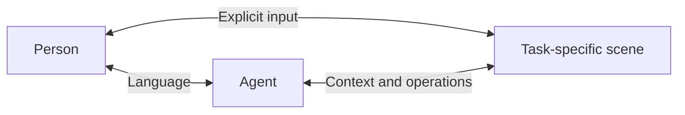

# openhax

**Open Human Agent Experience**

Interactive scenes for people and agents. Different tasks need different ways to communicate.
openhax brings selections, regions, time and space into the conversation when words alone are not
direct, precise or efficient enough.

## Vision

People express their goals and work with an agent to move the task forward. The agent organizes
tools and execution. An interactive scene gives both sides a shared view: people select, enter, mark
and explicitly submit information; the agent reads that context and presents or changes the result.
A scene can support a decision, an explanation or an exploration as well as an edit.



As the task changes, the interaction can take a different form while retaining the context it needs.
Workspaces are an internal way to group files and app state; they do not define the product
experience or imply one workspace per goal. The current scope uses deliberate selections, input,
annotations and submissions. It does not infer intent from passive clicks, pointer movement or
viewing behavior.

The engineering direction is a small, open collaboration contract that makes more scenes easier to
build. Each app should define its own context, operations and explicit user inputs. Shared
infrastructure should handle identity, routing, references and operation results without imposing a
universal domain model. The current implementation and remaining boundaries are described in
[Architecture](docs/canonical/architecture.md).

## Status

Two local apps exercise the collaboration model. Video Editor supports Hyperframes source, Remotion
source and MP4/WebM files, with playback, selected HTML edits, time/region feedback, history and
export. 3D Space provides a Three.js viewport, object manipulation, model imports and spatial
feedback. These are the first interaction scenes, not the limit of the project.

Shared identity, page/session pairing, material references and browser helpers are implemented. Both
apps capture explicit feedback, route it to an existing Codex task and accept checked changes. Their
context and operation APIs remain app-specific. A common capability-discovery interface, generic
input/action contract, automatic scene switching and custom app build management are not
implemented. Other agents can use source and HTTP workflows; feedback delivery currently supports
Codex only.

## Install and use

With Node.js 24 and npm available, install both skills for your agent:

```sh
npx skills add zhm9484/openhax --skill openhax-workspace openhax-video-editor
```

Install both skills from the same ref. To try an unpublished checkout, use
`npx skills add . --skill openhax-workspace openhax-video-editor` from this repository.

For 3D work, replace `openhax-video-editor` with `openhax-3d-space`.

Ask your agent to use Video Editor or 3D Space. Its skill includes the built web app; the Workspace
skill prepares and starts the matching local service and connects the page to the current Codex
task. First-time dependency/browser preparation needs network access. Other agents can use source
and HTTP workflows; feedback delivery currently supports Codex only. See
[skills](docs/canonical/skills.md).

## Develop

Use Node.js 24 and pnpm 10.34.5.

```sh
pnpm install
pnpm dev
```

Open the Video Editor URL printed by the service; its port is selected automatically. Run
`pnpm check` to verify formatting, lint, types, tests and production builds. Use `pnpm format` to
format files.

## Structure

```text
apps/
  video-editor/     React + Vite video editor
  3d-space/         React + Three.js scene collaboration
packages/
  protocol/         Shared collaboration contract
  scene-domain/     3D Space manifests, placements and spatial feedback
  video-domain/     Source documents, feedback intents and timeline operations
  video-runtime/    Hyperframes, Remotion and media playback adapters
  sdk/              Browser app instance and session-binding helpers
  adapter-codex/    Codex-specific connection
  local-server/     TypeScript backend
docs/
  canonical/        Current project facts and architecture
  non-canonical/    Research, plans, and historical context
```

All project code is TypeScript. Repository content is in English. Packages keep video behavior,
portable contracts, system access and Codex delivery separate. Local data defaults to `~/.openhax/`.
Use `pnpm build && pnpm start` to serve the app builds from their `skills/openhax-*/dist/`
directories. Builds remain separate from workspace files and app state. Chrome is required for
thumbnails and rendering; see the runtime settings in the canonical docs.

The protocol stays independent of React, Codex, and video or 3D engines. See
[Canonical documentation](docs/canonical/README.md) for current behavior and
[Non-canonical notes](docs/non-canonical/README.md) for research and plans.

## Contributing

See [Contributing](CONTRIBUTING.md) for issue and PR guidance, verification expectations and review
policy. Prefer English for discussions; repository content must be in English.

## License

[MIT](LICENSE). Third-party dependencies and assets retain their own licenses.

An independent project, not an official OpenAI product.
