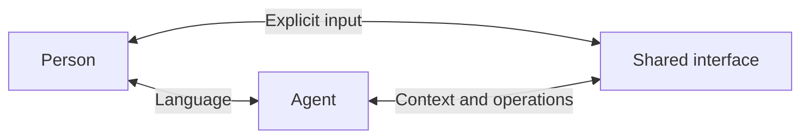

# openhax

**Open Human Agent Experience**

openhax builds interfaces for people and AI agents to work together beyond chat.

## Vision

We believe people will increasingly work through agents. As agents handle tools and execution,
software should help people understand and guide the work. The interface should fit the task.



Our goal is an open protocol that makes these interfaces easy to build. Each app defines how people
and agents work together; shared infrastructure connects them. See
[Architecture](docs/canonical/architecture.md) for the implemented protocol and its current limits.

## Status

The project currently includes two local apps. Video Editor supports Hyperframes source, Remotion
source and MP4/WebM files, with playback, selected HTML edits, time/region feedback, history and
export. 3D Space provides a Three.js viewport, object manipulation, model imports and spatial
feedback.

Shared identity, page/session pairing, material references and browser helpers are implemented. Both
apps capture explicit feedback, route it to an existing Codex task and accept checked changes. Their
context and operation APIs remain app-specific. A common capability-discovery interface, generic
input/action contract, automatic app switching and custom app build management are not implemented.
Other agents can use source and HTTP workflows; feedback delivery currently supports Codex only.

## Install and use

With Node.js 24 and npm available, install both skills for your agent:

```sh
npx skills add zhm9484/openhax --skill openhax-workspace openhax-video-editor
```

Install both skills from the same ref. To try an unpublished checkout, use
`npx skills add . --skill openhax-workspace openhax-video-editor` from this repository.

For 3D work, replace `openhax-video-editor` with `openhax-3d-space`.

Ask your agent to use Video Editor or 3D Space. Its skill includes the built web app; the Workspace
skill prepares and starts the matching local service and connects the page to the current Codex
task. First-time dependency/browser preparation needs network access. Other agents can use source
and HTTP workflows; feedback delivery currently supports Codex only. See
[skills](docs/canonical/skills.md).

## Develop

Use Node.js 24 and pnpm 10.34.5.

```sh
pnpm install
pnpm dev
```

Open the Video Editor URL printed by the service; its port is selected automatically. Run
`pnpm check` to verify formatting, lint, types, tests and production builds. Use `pnpm format` to
format files.

## Structure

```text
apps/
  video-editor/     React + Vite video editor
  3d-space/         React + Three.js scene collaboration
packages/
  protocol/         Shared collaboration contract
  scene-domain/     3D Space manifests, placements and spatial feedback
  video-domain/     Source documents, feedback intents and timeline operations
  video-runtime/    Hyperframes, Remotion and media playback adapters
  sdk/              Browser app instance and session-binding helpers
  adapter-codex/    Codex-specific connection
  local-server/     TypeScript backend
docs/
  canonical/        Current project facts and architecture
  non-canonical/    Research, plans, and historical context
```

All project code is TypeScript. Repository content is in English. Packages keep video behavior,
portable contracts, system access and Codex delivery separate. Local data defaults to `~/.openhax/`.
Use `pnpm build && pnpm start` to serve the app builds from their `skills/openhax-*/dist/`
directories. Builds remain separate from workspace files and app state. Chrome is required for
thumbnails and rendering; see the runtime settings in the canonical docs.

The protocol stays independent of React, Codex, and video or 3D engines. See
[Canonical documentation](docs/canonical/README.md) for current behavior and
[Non-canonical notes](docs/non-canonical/README.md) for research and plans.

## Contributing

See [Contributing](CONTRIBUTING.md) for issue and PR guidance, verification expectations and review
policy. Prefer English for discussions; repository content must be in English.

## License

[MIT](LICENSE). Third-party dependencies and assets retain their own licenses.

An independent project, not an official OpenAI product.
